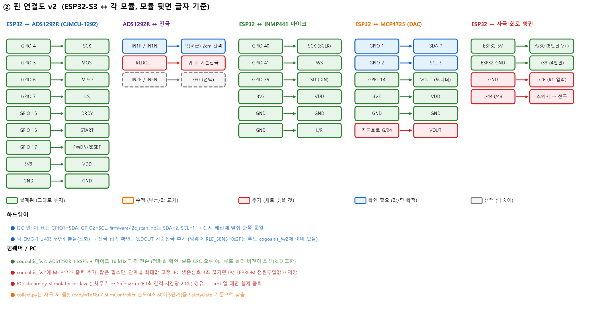
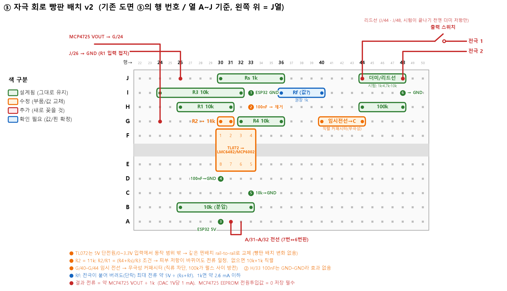

# 코골티스 (CoGoalTis)

이어버드형 센서로 **이갈이(턱 근전도, EMG)** 와 **코골이(마이크 소리)** 를 감지하고,
측정 데이터를 **실시간 그래프로 보면서 저장**하는 캡스톤디자인 프로젝트입니다. (2026년 2학기)

> **안전 안내**
> 이 저장소의 소프트웨어와 펌웨어는 **사람 몸에 전기 자극을 내보내지 않습니다.** 자극 출력 함수는 일부러 비어 있습니다.
> 전극을 몸에 붙일 때는 USB 아이솔레이터와 노트북 배터리를 씁니다. 자세한 내용은 [docs/SAFETY.md](docs/SAFETY.md).

## 현재 상태 (2026-11-12 기준)

| 영역 | 상태 |
|---|---|
| 하드웨어 | ESP32-S3 + CJMCU-1292(ADS1292R) + INMP441 마이크. 빵판 시제품 |
| ADS1292R 동작 | **확인됨** (ID 0x73, 1000 SPS, 패킷 오류 0까지 확인) |
| ESP32 -> PC 데이터 경로 | **확인됨** (USB 시리얼 921600 baud, CRC 오류 0, 약 1000 Hz) |
| 턱 EMG 반응 | 힘주기 시험에서 휴식 대비 **5.2배** 반응 확인. 그 뒤 실시간 수집에서는 입력 포화로 감지 못함(전극 접촉 확인 필요) |
| 마이크 | 수집 그래프에서 소리에 반응하는 모습 확인. 단독 점검(`check_audio.py`) 결과는 아직 기록 없음 |
| 이갈이 감지 | 실제 이갈이/물기 감지 사례는 수집 기록에 아직 없음 |
| 코골이 감지 | 규칙은 있으나 실제 코골이로 검증 못 함. 오탐을 줄이도록 판정 규칙 수정함 |
| 수면 단계(EEG) | 미구현 (전극 채널이 하나라서 현재 EMG만 사용) |
| 전기 자극 | **구현하지 않음** (안전 검토/승인 전) |
| 정확도(F1) 평가 | 평가 코드는 있음. 실측 정답(라벨) 데이터는 아직 없음 |

자세한 현황은 [docs/STATUS.md](docs/STATUS.md), 시험 기록은 [docs/TEST_LOG.md](docs/TEST_LOG.md)를 보세요.

## 배선도 v2 (현재 설계 + 고칠 부분, 2026-11-21)

색 구분: 🟢 설계됨(그대로 유지) · 🟠 수정(부품/값 교체) · 🔴 추가(새로 꽂을 것) · 🔵 확인 필요(값/핀 확정) · ⚪ 선택

> 아래 도면은 맨 아래 기존 도면(빵판 BB1~3, 핀 연결도, 자극 회로 ③)을 바탕으로 다시 그린 것입니다.
> 도면에 표시가 없던 연결(DAC 입력, R1 기준)은 추정해서 그렸으니 실제 빵판과 다르면 알려 주세요.
> **🔴/🟠 항목을 모두 반영하고 더미 저항 시험을 통과하기 전에는 리드선(J/44·J/48)에 전극을 연결하지 않습니다.**





### 자극 회로 빵판: 몇 번에 무엇을 꽂는지

| 위치 (열/행) | 부품 | 상태 | 할 일 |
|---|---|---|---|
| F~E / 30~33 (가운데 홈 걸침) | op-amp (1~4번 핀 F행, 8~5번 핀 E행) | 🟠 수정 | TL072 → **LMC6482 또는 MCP6002** (같은 8핀 배치, 자리 그대로). TL072는 5V 단전원·0~3.3V 입력에서 동작 범위 밖 |
| J / 30–36 | Rs 1k (전류 감지) | 🟢 유지 | |
| I / 24–32 | R3 10k | 🟢 유지 | |
| H / 26–31 | R1 10k | 🟢 유지 | |
| G / 30–31 | R2 (1번↔2번 핀 귀환) | 🟠 수정 | **11k** (없으면 10k+1k 직렬). R2/R1 = (R4+Rs)/R3 조건 |
| G / 32–36 | R4 10k | 🟢 유지 | |
| I / 36–40 | Rf | 🔵 확인 | 값 확정 필요. 권장 1k (전극 단락 시 최대 약 2.6 mA) |
| G / 40–44 | 임시 전선 | 🟠 수정 | **무극성 커패시터**로 교체 (직류 차단) |
| H / 44–48 | 100k | 🟢 유지 | 펄스 사이 커패시터 방전 |
| J / 44–48 | 더미 저항 → 나중에 리드선 | 🟢 유지 | 시험은 1k · 4.7k · 10k 차례로 |
| I / 33 ① | ESP32 GND (4번 핀) | 🟢 유지 | |
| H / 33 ② | 100nF | 🟠 수정 | GND–GND라 효과 없음 → **제거** (④가 이미 전원 디커플링) |
| A / 30 ③ | ESP32 5V (8번 핀) | 🟢 유지 | |
| D / 30 ④ | 100nF → GND | 🟢 유지 | |
| C / 33 ⑤ | 10k → GND | 🟢 유지 | |
| B / 26–33 | 10k (분압) | 🟢 유지 | B/26 끝은 비워 둠 |
| I / 48 ⑥ | 전선 → GND | 🟢 유지 | |
| **G / 24** | MCP4725 VOUT → R3 입력 | 🔴 추가 | GPIO14 모니터 선은 그대로 둠 |
| **J / 26** | GND → R1 입력 | 🔴 추가 | 전류 = VOUT × 1.1 mA/V (R2 11k 기준, DAC 1V당 1.1 mA) |
| **A / 31–32** | 전선 (7번↔6번 핀) | 🔴 추가 | 안 쓰는 B채널 안정화 |
| **J / 44 리드선** | 출력 스위치 | 🔴 추가 | 손으로 끊을 수 있는 직렬 스위치 |

### 모듈 연결

| 연결 | 상태 | 비고 |
|---|---|---|
| ESP32 ↔ ADS1292R (GPIO 4·5·6·7·15·16·17, 3V3, GND) | 🟢 유지 | ID 0x73, 1 kSPS 확인됨 |
| ESP32 ↔ INMP441 (GPIO 40·41·39, 3V3, GND, L/R→GND) | 🟢 유지 | |
| ESP32 ↔ MCP4725 VDD·GND, VOUT→GPIO14 | 🟢 유지 | 책상 점검용 모니터 |
| ESP32 ↔ MCP4725 SDA/SCL | 🔵 확인 | 이 표는 GPIO1=SDA, GPIO2=SCL / `firmware/i2c_scan.ino`는 SDA=2, SCL=1 → 실제 배선에 맞춰 통일 |
| ADS1292R IN1P/IN1N → 턱(교근) | 🔵 확인 | ±403 mV 포화 → 전극 접촉 확인 |
| ADS1292R RLDOUT → 귀 뒤 기준전극 | 🔴 추가 | 펌웨어 RLD 설정은 루트 `cogoaltis_fw2`에 이미 있음 |
| ADS1292R IN2P/IN2N → EEG | ⚪ 선택 | 수면 단계용 |

### 펌웨어 / PC

| 항목 | 상태 |
|---|---|
| `cogoaltis_fw2` 센서 패킷 전송 (컴파일 확인, 실측 CRC 오류 0). 루트 폴더 버전이 최신(RLD 포함) | 🟢 |
| `cogoaltis_fw2`에 MCP4725 출력: 짧은 펄스만, 단계별 최대값 고정, PC 생존신호 3초 끊기면 0V, EEPROM 전원투입값 0 저장 | 🔴 추가 |
| `stream.py` `Stimulator.set_level()` 채우기 → `SafetyGate` 경유, `--arm`일 때만 출력 | 🔴 추가 |
| `StimController` 한도(4초·시간당 60회·5단계)를 `SafetyGate`(60초·시간당 20회) 기준으로 / `collect.py`는 자극 꺼 둠 | 🟠 수정 |

## 구성

```
센서: ADS1292R(턱 EMG) + INMP441(소리)
  -> ESP32-S3 (읽어서 패킷으로 보냄)  firmware/cogoaltis_fw2
  -> USB 시리얼 (아이솔레이터 경유)
  -> PC: 신호처리 -> 이갈이/코골이 판정 -> 실시간 그래프 + 파일 저장  collect.py
```

## 빠른 시작

```
pip install numpy scipy matplotlib pyserial
pip install koreanize-matplotlib      # 선택: 그래프 한글 글꼴

python collect.py --fake --minutes 8  # 장치 없이 가짜 데이터로 시험 (결과는 collections/ 에 저장)
python collect.py COM4                # 실제 장치: 실시간 그래프 + 저장 (창을 닫으면 종료)
python collect.py COM4 --no-gui       # 창 없이 저장만 (밤샘 측정용)
```

- 펌웨어: Arduino IDE에서 `firmware/cogoaltis_fw2`를 업로드합니다.
  보드 `ESP32S3 Dev Module`, USB CDC On Boot = Disabled, 케이블은 보드에 "UART"라고 인쇄된 포트에 꽂습니다.
- COM 번호는 바뀔 수 있습니다. `python serial_source.py --list`로 확인하세요. Serial Monitor는 닫고 실행합니다.
- 시작 후 처음 10초는 조용히 있어야 합니다(평소 잡음을 배우는 시간).
- 명령 프롬프트 도우미: `fw.bat` (`fw help`). 보드에 올리거나 전극을 쓰는 명령은 YES 확인을 먼저 합니다.

## 폴더 구조

| 경로 | 내용 |
|---|---|
| `collect.py` | **실시간 수집기**: 3단 그래프, 이벤트/요약/원본 저장 |
| `stream.py`, `config.py` | 실시간 신호처리·판정(이갈이, 코골이)과 모든 설정값 |
| `packet.py`, `serial_source.py`, `session_logger.py` | 장치 패킷 형식, 시리얼 입력, 원본 저장 |
| `check_stream.py`, `check_audio.py`, `emg_clench_test.py`, `report_test.py`, `view_session.py` | 점검·시험·다시 보기 도구 |
| `dashboard.py`, `run_demo.py`, `fake_device.py`, `mock_source.py`, `synth.py`, `detect.py`, `evaluate.py`, `dataio.py` | 가짜 데이터 데모, 오프라인 분석, 평가 |
| `firmware/` | Arduino 스케치. 본 펌웨어 `cogoaltis_fw2`, 나머지는 점검·진단용 |
| `docs/` | 현황, 하드웨어, 시험 기록, 안전, 문제 해결 |
| `fw.bat`, `CLAUDE.md` | 명령 프롬프트 도우미, Claude Code용 프로젝트 메모 |

## 문서

- [현황 브리핑](docs/STATUS.md) · [하드웨어 배선](docs/HARDWARE.md) · [시험 기록](docs/TEST_LOG.md)
- [안전 원칙](docs/SAFETY.md) · [문제 해결 모음](docs/TROUBLESHOOTING.md)

## 한계

- 이 프로젝트는 **연구용 비의료 시제품**이며 의료 진단이나 치료 효과를 주장하지 않습니다.
- 무호흡 의심 구간은 코골이 뒤 10~60초 무음 뒤 재개를 표시하는 단순 규칙이며 **진단이 아닙니다.**
- 감지 기준은 기본값이고 실제 데이터로 아직 튜닝하지 않았습니다.


- 
